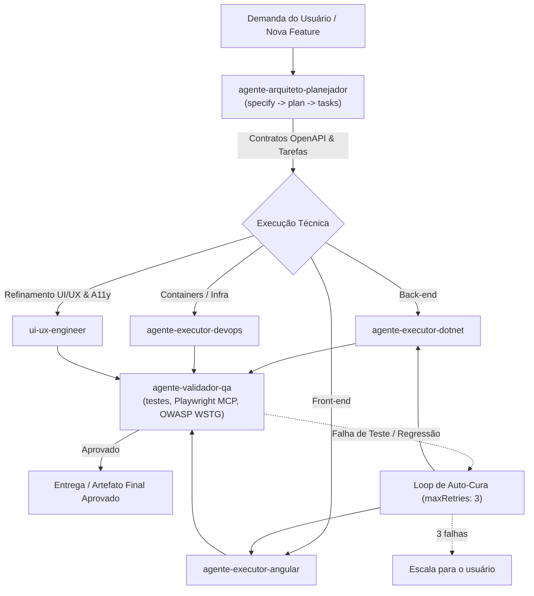

# {{PROJECT_NAME}} — Matriz de Agentes Autônomos
> Arquitetura de Divulgação Progressiva ([Progressive Disclosure](PROGRESSIVE_DISCLOSURE.md))

Este documento centraliza a descoberta (Camada 1), o protocolo de interação (Camada 2) e os apontadores para especificações profundas (Camada 3) dos 6 agentes autônomos do harness.

---

## Camada 1: Matriz de Descoberta dos Agentes (Lightweight Index)

> **Custo de Contexto:** ~70 tokens por linha. Consulte esta tabela para decidir qual agente ativar antes de carregar instruções detalhadas.

| ID do Agente | Papel Principal | Modelo Ideal | Gatilho de Ativação | Skills Primárias | Custo Token | Especificação (L3) |
| :--- | :--- | :--- | :--- | :--- | :--- | :--- |
| `agente-arquiteto-planejador` | Arquiteto de Software & Spec-Kit | Argon / Opus 5.5 | `specify`, `plan`, `tasks`, novos contratos OpenAPI | `skill-contratos-openapi`, `skill-owasp-top10-arquiteto` | Baixo | [spec-hub/.agents/agents/agente-arquiteto-planejador.md](spec-hub/.agents/agents/agente-arquiteto-planejador.md) |
| `agente-executor-dotnet` | Engenheiro Back-End .NET 10 | Gemini 3.8 Flash / Sonnet 5.5 | Alterações em `{{PROJECT_SLUG}}-backend-dotnet`, Clean Arch | `skill-clean-architecture-dotnet10`, `skill-mfa-totp-rfc6238`, `skill-owasp-top10-backend`, `skill-owasp-top10-pipeline-ia-dados` | Médio | [spec-hub/.agents/agents/agente-executor-dotnet.md](spec-hub/.agents/agents/agente-executor-dotnet.md) |
| `agente-executor-angular` | Engenheiro Front-End Angular | Gemini 3.8 Flash / Sonnet 5.5 | Alterações em `{{PROJECT_SLUG}}-frontend-angular`, Signals, Zoneless | `angular-ui-patterns`, `skill-contratos-openapi`, `skill-owasp-top10-frontend` | Médio | [spec-hub/.agents/agents/agente-executor-angular.md](spec-hub/.agents/agents/agente-executor-angular.md) |
| `agente-executor-devops` | Engenheiro DevOps & Containers | Gemini 3.8 Flash / Sonnet 5.5 | Alterações em `{{PROJECT_SLUG}}-infra-containers`, Docker Compose | `skill-owasp-top10-devops` | Baixo | [spec-hub/.agents/agents/agente-executor-devops.md](spec-hub/.agents/agents/agente-executor-devops.md) |
| `agente-validador-qa` | Engenheiro de QA & Auditoria | Sonnet 5.5 | Validação de Épico (`validate`), testes automatizados, auditoria visual Playwright MCP | `skill-contratos-openapi`, `skill-owasp-top10-qa` | Médio | [spec-hub/.agents/agents/agente-validador-qa.md](spec-hub/.agents/agents/agente-validador-qa.md) |
| `ui-ux-engineer` | Engenheiro Especialista UI/UX | Pro / Sonnet 5.5 | Design de interfaces, WCAG 2.1 AA, design tokens, ergonomia mobile | `frontend-design`, `web-design-guidelines`, `ui-ux-pro-max`, `bencium-ux-designer`, `accesslint`, `angular-ui-patterns`, `skill-owasp-top10-ui-ux` | Alto | [spec-hub/.agents/agents/ui-ux-engineer.md](spec-hub/.agents/agents/ui-ux-engineer.md) |

> **Adicionando agentes de domínio:** projetos com necessidades próprias (ex.: auditor de domínio, executor de outra stack) criam o agente com [`templates/agent-template.md`](templates/agent-template.md) e adicionam uma linha nesta tabela.

---

## Camada 2: Protocolos de Interação & Spec-Kit Handoffs (Outline)

> **Custo de Contexto:** ~450 tokens. Ciclo de vida e regras de transição entre agentes.

### Regras de Transição e Quality Gates
1. **Contract-First Imutável:** nenhum código de back-end ou front-end é iniciado sem que o endpoint esteja modelado em `{{PROJECT_SLUG}}-spec-hub/contracts/openapi.yaml`.
2. **Auditoria Visual Mandatória:** toda alteração de interface exige que o `agente-validador-qa` capture screenshots via Playwright MCP e registre em `{{PROJECT_SLUG}}-frontend-angular/playwright-audit/`.
3. **Imutabilidade dos Dados de Entrada:** `data/input` é montado somente leitura (`:ro`); toda saída vai para `data/output/`.
4. **Auto-Cura Bounded:** conforme `.antigravity/permissions.json`, falhas de build/teste permitem até 3 tentativas (`maxRetries: 3`) antes de escalar ao usuário.
5. **Handoff Documentado:** cada transição entre agentes usa [`templates/handoff-template.md`](templates/handoff-template.md) (escopo, contratos tocados, comandos de verificação).

---

## Camada 3: Catálogo de Referência Profunda (Deep Retrieval)

Consulte a especificação completa de um agente somente quando ele for acionado:
- [Arquiteto](spec-hub/.agents/agents/agente-arquiteto-planejador.md)
- [Executor .NET](spec-hub/.agents/agents/agente-executor-dotnet.md)
- [Executor Angular](spec-hub/.agents/agents/agente-executor-angular.md)
- [Executor DevOps](spec-hub/.agents/agents/agente-executor-devops.md)
- [Validador QA](spec-hub/.agents/agents/agente-validador-qa.md)
- [UI/UX Engineer](spec-hub/.agents/agents/ui-ux-engineer.md)
