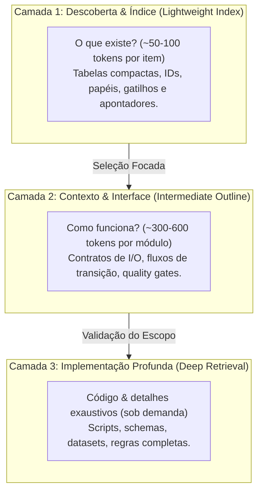

# Padrão Progressive Disclosure no {{PROJECT_NAME}}
> Baseado na especificação do [Claude-Mem Progressive Disclosure](https://docs.claude-mem.ai/progressive-disclosure)

Este documento estabelece o padrão de **Progressive Disclosure (Divulgação Progressiva)** para todo o ecossistema: workspace raiz, repositórios, agentes, skills e harness.

---

## 1. Filosofia e Princípios Centrais

O padrão combate a sobrecarga de contexto (*context bloat*). Em sistemas multi-agentes, injetar manuais extensos, código bruto ou catálogos inteiros no início da sessão degrada a atenção do modelo e desperdiça tokens. Adotamos a regra do **Need-to-Know**:



---

## 2. A Arquitetura de 3 Camadas

| Camada | Escopo | Custo por Item | Pergunta Respondida | Onde Reside |
| :--- | :--- | :--- | :--- | :--- |
| **1 (Index / Discovery)** | Matriz resumida: IDs, gatilhos, caminhos | ~50–100 tokens | *"O que existe e qual componente devo acionar?"* | `AGENTS.md`, `SKILLS.md`, `HARNESS.md`, `README.md` (tabelas de topo) |
| **2 (Outline / Interface)** | Fluxo, contratos de I/O, dependências, critérios de saída | ~300–600 tokens | *"Como se integra e quais são os limites?"* | Seções de arquitetura dos `README.md`, cabeçalhos de `SKILL.md` |
| **3 (Deep Retrieval)** | Código-fonte, scripts, datasets, prompts completos | Sob demanda | *"Quais os detalhes exatos para executar?"* | `spec-hub/.agents/**`, `src/`, `scripts/`, `data/*.csv` |

---

## 3. O File Read Gate (Portão de Leitura de Arquivos)

1. **Sem leitura cega:** antes de ler arquivo com mais de 100 linhas, consulte o índice de Camada 1 ou o sumário de Camada 2.
2. **Leitura por janelas:** use `StartLine`/`EndLine` focando a função, classe ou bloco necessário.
3. **Outlines primeiro:** prefira busca, lista de símbolos e sumários a ler arquivos completos.
4. **Datasets protegidos:** em skills com bases volumosas (ex.: `ui-ux-pro-max`), use os scripts CLI (`scripts/search.py`) em vez de abrir `.csv`/`.json`.

---

## 4. Estrutura de Navegação Progressiva

```
{{PROJECT_SLUG}}-workspace/
├── PROGRESSIVE_DISCLOSURE.md   # [Este arquivo] Padrão e governança de contexto
├── AGENTS.md                   # L1/L2: Matriz dos agentes e fluxos de transição
├── SKILLS.md                   # L1/L2: Catálogo de skills por domínio
├── HARNESS.md                  # L1/L2: Matriz de testes, build e validação
├── README.md                   # L1: Visão geral e estratégia de fluxo autônomo
├── templates/                  # Templates reutilizáveis (agentes, skills, ADR, repos...)
├── .agents/  ──(junction)──►   {{PROJECT_SLUG}}-spec-hub/.agents
├── {{PROJECT_SLUG}}-backend-dotnet/   (AGENTS.md + README.md)
├── {{PROJECT_SLUG}}-frontend-angular/ (AGENTS.md + README.md)
├── {{PROJECT_SLUG}}-infra-containers/ (AGENTS.md + README.md)
└── {{PROJECT_SLUG}}-spec-hub/
    ├── AGENTS.md / README.md   # L1/L2: Governança Spec-Kit e contratos
    ├── .agents/                # L3: Especificações de agentes e skills
    ├── .specify/               # Engine Spec-Kit (templates, scripts, constituição)
    ├── contracts/              # L3: OpenAPI 3.1 e eventos em tempo real
    └── specs/                  # L3: Especificações por feature (NNN-nome/)
```
