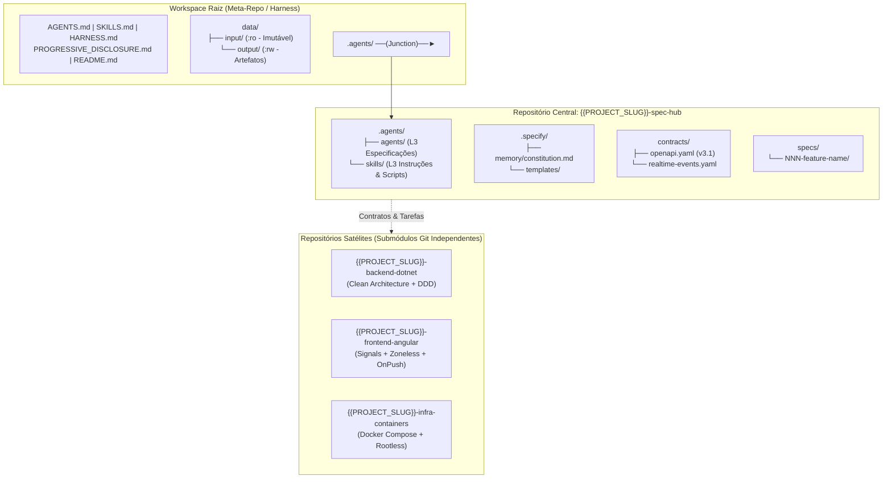
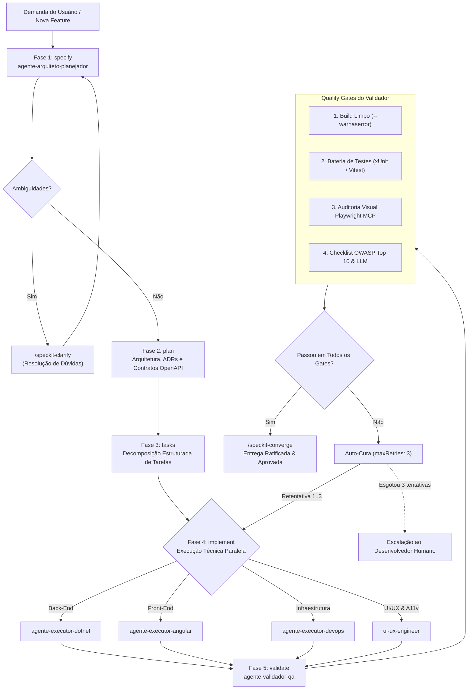

# AI Harness Template — Framework de Engenharia & Agentes Autônomos
> Arquitetura de Divulgação Progressiva ([Progressive Disclosure](PROGRESSIVE_DISCLOSURE.md)) | Metodologia **Spec-Kit** & **Contract-First**

O **AI Harness Template** é um acelerador arquitetural para criação de projetos de software complexos orientados a **Agentes Autônomos de IA**. Ele combina engenharia de software rigorosa (Clean Architecture, DDD, OpenAPI 3.1, OWASP Top 10, WCAG 2.1 AA) com governança avançada de contexto e orquestração autônoma de múltiplos agentes.

---

## 1. Estratégia de Organização do Ecossistema

O template adota um padrão de **Meta-Repositório com Repositórios Satélites**, onde a inteligência, especificações, contratos e diretrizes residem em um repositório centralizado de verdade absoluta (**`spec-hub`**).



### 1.1. Single Source of Truth (`spec-hub`)
Nenhuma linha de código de negócio, endpoint REST ou mensagem em tempo real é iniciada nos repositórios executores sem que antes esteja modelada e ratificada no `spec-hub`:
- **Contratos Formais:** `contracts/openapi.yaml` e `contracts/realtime-events.yaml`.
- **Constituição do Projeto:** `.specify/memory/constitution.md` define princípios invioláveis, limites de recursos e regras imutáveis.
- **Especificações de Funcionalidades:** `specs/NNN-feature/` contém o ciclo completo de spec, plan e tasks.

### 1.2. Governança de Contexto: Padrão Progressive Disclosure & File Read Gate
Para mitigar a sobrecarga de contexto (*context bloat*) e evitar alucinações, o projeto adota estritamente a arquitetura de 3 camadas inspirada no padrão *Claude-Mem*:

1. **Camada 1 (Índice de Descoberta - ~50 a 100 tokens):** Tabelas enxutas nos arquivos `AGENTS.md`, `SKILLS.md`, `HARNESS.md` e cabeçalhos de repositório. O agente responde: *"O que existe e quem devo acionar?"*.
2. **Camada 2 (Outline de Integração - ~300 a 600 tokens):** Sumários de arquitetura, contratos de entrada/saída e dependências. O agente responde: *"Como esse módulo interage e quais são suas fronteiras?"*.
3. **Camada 3 (Implementação Profunda - Sob Demanda):** Código-fonte, scripts, schemas exaustivos e prompts completos. O agente responde: *"Quais são os detalhes exatos para execução?"*.

> **O File Read Gate:** Proíbe a leitura cega de arquivos inteiros (> 100 linhas). Agentes devem consultar os índices de Camada 1, selecionar o trecho exato e usar leitura cirúrgica (`StartLine`/`EndLine`). Datasets volumosos (como as tabelas da skill `ui-ux-pro-max`) são consultados exclusivamente via CLI (`scripts/search.py`).

---

## 2. Estratégia de Fluxo Autônomo (Autonomous Lifecycle)

O fluxo autônomo opera em um ciclo contínuo de **5 Fases Spec-Kit**, suportado por **Quality Gates Determinísticos** e um protocolo de **Auto-Cura Bounded (Self-Healing)**:



### 2.1. Detalhamento das 5 Fases
1. **Fase 1 (`specify`):** O `agente-arquiteto-planejador` estrutura a demanda em histórias de usuário (`US`), requisitos funcionais e critérios de aceite mensuráveis em formato Gherkin.
2. **Fase 2 (`plan`):** O arquiteto formula o plano técnico, modela dados em `data-model.md`, registra decisões estruturantes em ADRs e publica novos endpoints em `contracts/openapi.yaml`.
3. **Fase 3 (`tasks`):** Quebra do plano em tarefas atômicas com IDs sequenciais (`T001`, `T002`), marcando dependências e o agente responsável.
4. **Fase 4 (`implement`):** Os agentes executores implementam o código estritamente aderente aos contratos. Nenhuma alteração manual fora do contrato é aceita.
5. **Fase 5 (`validate`):** O `agente-validador-qa` executa a bateria de validação, incluindo auditoria visual contínua via Playwright MCP (capturando screenshots desktop e mobile em `playwright-audit/`) e verificação OWASP WSTG.

### 2.2. Protocolo de Auto-Cura e Limite de Agência (Self-Healing Bounded)
Conforme configurado em `.antigravity/permissions.json`:
- Se um comando falhar durante o build ou teste, o sistema aciona automaticamente o agente responsável com o trecho de erro do log.
- O loop de correção tem limite estrito de **3 tentativas (`maxRetries: 3`)** e **tempo limite de 300 segundos**.
- Caso a falha persista após 3 tentativas, o agente é instruído a interromper o loop e apresentar o diagnóstico claro ao desenvolvedor humano, evitando consumo infinito de tokens.

---

## 3. Matriz de Agentes & Skills Incluídos

O template inclui 6 agentes autônomos e 26 skills modulares organizadas por especialidade:

### 3.1. Agentes Especialistas ([`AGENTS.md`](AGENTS.md))
- **`agente-arquiteto-planejador`**: Lidera o ciclo Spec-Kit (`specify`, `plan`, `tasks`), modelagem de contratos OpenAPI 3.1 e segurança arquitetural.
- **`agente-executor-dotnet`**: Especialista em back-end .NET 10, Clean Architecture, DDD, Result Pattern e APIs REST seguras.
- **`agente-executor-angular`**: Especialista em front-end Angular moderno, Signals Zoneless, Standalone Components e OnPush.
- **`agente-executor-devops`**: Engenheiro de Docker Compose, conteinerização rootless, redes isoladas e healthchecks.
- **`agente-validador-qa`**: Engenheiro de testes, conformidade de contratos, testes de regressão e auditoria visual via Playwright MCP.
- **`ui-ux-engineer`**: Especialista em design system tokens, ergonomia mobile, microinterações e acessibilidade WCAG 2.1 AA.

### 3.2. Skills Técnicas ([`SKILLS.md`](SKILLS.md))
- **Arquitetura & Código:** `skill-contratos-openapi`, `skill-clean-architecture-dotnet10`, `skill-mfa-totp-rfc6238`.
- **Segurança OWASP Top 10 Full-Stack:** `skill-owasp-top10-arquiteto`, `skill-owasp-top10-backend`, `skill-owasp-top10-frontend`, `skill-owasp-top10-devops`, `skill-owasp-top10-qa`, `skill-owasp-top10-pipeline-ia-dados`, `skill-owasp-top10-ui-ux`.
- **Design & Acessibilidade:** `angular-ui-patterns`, `frontend-design`, `web-design-guidelines`, `ui-ux-pro-max`, `bencium-ux-designer`, `accesslint`.
- **Engine Spec-Kit:** 10 skills para ciclo SDD completo (`speckit-constitution`, `speckit-specify`, `speckit-plan`, `speckit-tasks`, etc.).

---

## 4. A Pasta de Templates (`templates/`)

O diretório [`templates/`](templates/) disponibiliza todos os esqueletos necessários para estender o projeto de forma padronizada:

```
templates/
├── README.md                      # Catálogo e instruções de uso dos templates
├── agent-template.md              # Template para novos agentes especialistas
├── skill-template.md              # Template para novas skills modulares
├── adr-template.md                # Template de Architecture Decision Record
├── handoff-template.md            # Protocolo de transferência entre agentes
├── validation-report-template.md  # Relatório formal de auditoria QA pós-feature
├── openapi-template.yaml          # Contrato base OpenAPI 3.1 inicial
├── realtime-events-template.yaml  # Contrato base de eventos em tempo real
├── feature-spec-template/         # Pasta completa de spec de nova feature
└── repo-templates/                # Templates para repositórios satélites (Backend, Frontend, Infra)
```

---

## 5. Como Criar um Novo Projeto a partir deste Template

### Passo 1: Copiar o Template para o Novo Diretório
```powershell
Copy-Item -Path "c:\ai-projects\ai-harness-template" -Destination "c:\ai-projects\meu-novo-projeto" -Recurse
cd "c:\ai-projects\meu-novo-projeto"
```

### Passo 2: Executar o Script de Inicialização
Execute o script utilitário para substituir placeholders e configurar as junctions de agentes:
```powershell
.\scripts\init-project.ps1 -ProjectName "Meu Sistema Incrível" -ProjectSlug "meu-sistema"
```
O script realizará automaticamente:
1. Substituição de `{{PROJECT_NAME}}`, `{{PROJECT_SLUG}}`, caminhos e datas em todos os `.md`, `.json`, `.yaml`.
2. Criação da junction do Windows `.agents` na raiz apontando para `spec-hub\.agents`.
3. Provisionamento do arquivo `.env` inicial a partir de `.env.example`.

### Passo 3: Inicializar os Repositórios Git
Você pode inicializar o workspace como um meta-repositório com submódulos ou como repositório unificado:
```powershell
git init
cd spec-hub && git init && cd ..
```

### Passo 4: Definir a Constituição e Iniciar a Primeira Feature
1. Abra o arquivo `spec-hub/.specify/memory/constitution.md` e ajuste os princípios invariantes da sua aplicação.
2. Inicie a primeira funcionalidade via chat com o agente ou executando o comando:
```text
/speckit-specify "Implementar o sistema de cadastro e autenticação de usuários com MFA TOTP"
```
O `agente-arquiteto-planejador` assumirá a condução do fluxo autônomo!
