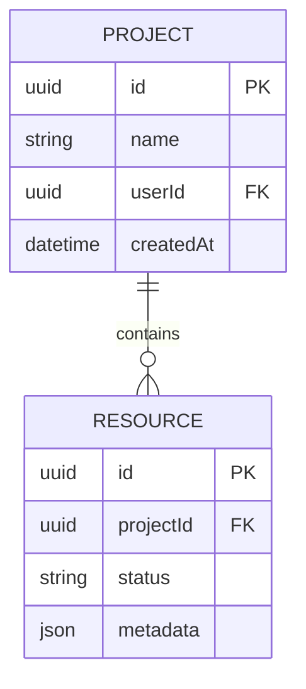

# Data Model: {{FEATURE_NAME}}

## Entidades & Agregados

## Regras de Integridade
1. Todo recurso deve possuir vínculo obrigatório com um Tenant ou `UserId` para evitar falhas BOLA (OWASP API1:2023).
2. Índices de unicidade aplicados sobre campos chave de busca.
